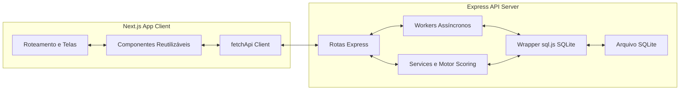

# AUTOMAÇÃO DE LEADS — Arquitetura Atual do Sistema

O sistema é desenhado sob uma arquitetura de cliente-servidor desacoplada. O frontend (Next.js) comunica-se com o backend (Node.js/Express) por meio de requisições HTTP RESTful. O banco de dados SQLite é persistido localmente no backend.

---

## 🏗️ Divisão de Responsabilidades

### 1. Backend ([`/backend`](file:///c:/Users/55119/OneDrive/Documentos/AUTOMA%C3%87%C3%83O%20DE%20DIAGNOSTICO/backend))
* **Servidor HTTP:** Implementado no arquivo [`src/server.js`](file:///c:/Users/55119/OneDrive/Documentos/AUTOMA%C3%87%C3%83O%20DE%20DIAGNOSTICO/backend/src/server.js) usando Express. Ele carrega as variáveis de ambiente, inicializa a conexão com o banco de dados e expõe as rotas com middlewares de CORS e tratamento centralizado de erros.
* **Persistência de Dados:** Centralizada em [`database.js`](file:///c:/Users/55119/OneDrive/Documentos/AUTOMA%C3%87%C3%83O%20DE%20DIAGNOSTICO/backend/src/config/database.js). Como foi desenvolvida sobre o `sql.js` compilado em WebAssembly, a persistência lê o arquivo binário `.db` na inicialização e o escreve em disco após cada operação de escrita (`PRAGMA foreign_keys` é ativado para garantir integridade referencial nas deleções).
* **Fila de Trabalho Assíncrono:** O arquivo [`campaignWorker.js`](file:///c:/Users/55119/OneDrive/Documentos/AUTOMA%C3%87%C3%83O%20DE%20DIAGNOSTICO/backend/src/workers/campaignWorker.js) recebe requisições de varredura disparadas no ato de criação da campanha. Ele faz o loop de enriquecimento de dados fora do ciclo de requisição HTTP (utilizando `setTimeout` para evitar travamento da thread principal) e salva tudo progressivamente em banco antes de marcar o status da campanha como `completed`.
* **Mecanismo de Métricas e IA:** [`scoreService.js`](file:///c:/Users/55119/OneDrive/Documentos/AUTOMA%C3%87%C3%83O%20DE%20DIAGNOSTICO/backend/src/services/scoreService.js) calcula os índices DMS e COS, enquanto [`aiService.js`](file:///c:/Users/55119/OneDrive/Documentos/AUTOMA%C3%87%C3%83O%20DE%20DIAGNOSTICO/backend/src/services/aiService.js) gera inferências baseadas nesses dados técnicos.

---

### 2. Frontend ([`/frontend`](file:///c:/Users/55119/OneDrive/Documentos/AUTOMA%C3%87%C3%83O%20DE%20DIAGNOSTICO/frontend))
* **Barra de Navegação e Layout:** [`layout.js`](file:///c:/Users/55119/OneDrive/Documentos/AUTOMA%C3%87%C3%83O%20DE%20DIAGNOSTICO/frontend/app/layout.js) e [`Sidebar.js`](file:///c:/Users/55119/OneDrive/Documentos/AUTOMA%C3%87%C3%83O%20DE%20DIAGNOSTICO/frontend/components/ui/Sidebar.js) definem a casca corporativa da aplicação. A Sidebar é fixada e o painel de conteúdo consome o restante da largura de tela de forma rolável.
* **Controle de Estado de API:** Centralizado em [`api.js`](file:///c:/Users/55119/OneDrive/Documentos/AUTOMA%C3%87%C3%83O%20DE%20DIAGNOSTICO/frontend/lib/api.js) via cliente nativo `fetch`. O cliente trata cabeçalhos, erros de status HTTP e decodifica texto em caso de requisição para download de CSV.
* **Design System Reutilizável (`components/ui/`):** Todos os cards, botões, modais e badges foram desenvolvidos com estilos Tailwind CSS rígidos e semânticos, garantindo facilidade em caso de reestilização global (ex: [`ScoreBar.js`](file:///c:/Users/55119/OneDrive/Documentos/AUTOMA%C3%87%C3%83O%20DE%20DIAGNOSTICO/frontend/components/ui/ScoreBar.js) exibe barras de progresso que mudam de cor dinamicamente: vermelho para scores críticos < 40, amarelo para scores medianos < 70, e verde para bons scores >= 70).

---

## 🔄 Fluxo Ponta a Ponta: Prospecção de Lead

Abaixo está o ciclo de vida completo de uma operação, desde a digitação inicial até a cópia da abordagem:

1. **Entrada do Usuário:** O usuário aciona o botão circular `+` (FAB) na tela principal do dashboard. O [`NewCampaignModal.js`](file:///c:/Users/55119/OneDrive/Documentos/AUTOMA%C3%87%C3%83O%20DE%20DIAGNOSTICO/frontend/components/campaigns/NewCampaignModal.js) se abre com animação suave e solicita o Nicho e Localização.
2. **Criação da Tarefa:** O modal dispara um `POST /api/campaigns`. O backend cria a linha na tabela `campaigns` com status `processing` e retorna o objeto gerado contendo um UUID único. O frontend recebe este UUID e redireciona o usuário para `http://localhost:3000/campaigns/[uuid]`.
3. **Varredura (Background Worker):** Enquanto o frontend entra na tela da campanha e inicia um **polling de verificação** a cada 3 segundos, o backend delega a tarefa para [`campaignWorker.js`](file:///c:/Users/55119/OneDrive/Documentos/AUTOMA%C3%87%C3%83O%20DE%20DIAGNOSTICO/backend/src/workers/campaignWorker.js).
   - O worker invoca `apifyService.js` para obter os nomes e localizações das empresas locais.
   - Para cada empresa, o worker realiza requisições paralelas simuladas para obter a performance web (`pagespeedService.js`) e redes sociais (`socialService.js`).
   - O worker calcula as notas DMS/COS e insere a empresa como linha na tabela `leads` referenciando o ID da campanha.
   - Finalizado o loop, o worker atualiza o status da campanha em banco para `completed` e grava o contador de `total_leads`.
4. **Resolução no Cliente:** O polling do frontend detecta que a campanha agora está `completed`, cessa as requisições de status, faz o fetch de `/api/campaigns/:id/leads` e renderiza a tabela interativa de leads com paginação e filtros dinâmicos.
5. **Geração de Diagnóstico:** O vendedor clica em "Ver Diagnóstico" em um lead de alta pontuação (Prioridade A), abrindo a página de detalhe. Se for a primeira visualização, o botão "Gerar Diagnóstico com IA" estará disponível. Ao clicar, o frontend envia um `POST /api/leads/:leadId/diagnostic` para o backend, que executa o `aiService.js`, salva no banco de dados e retorna os textos de diagnóstico nas abas de fatos, inferências e o draft de e-mail pronto para cópia.
