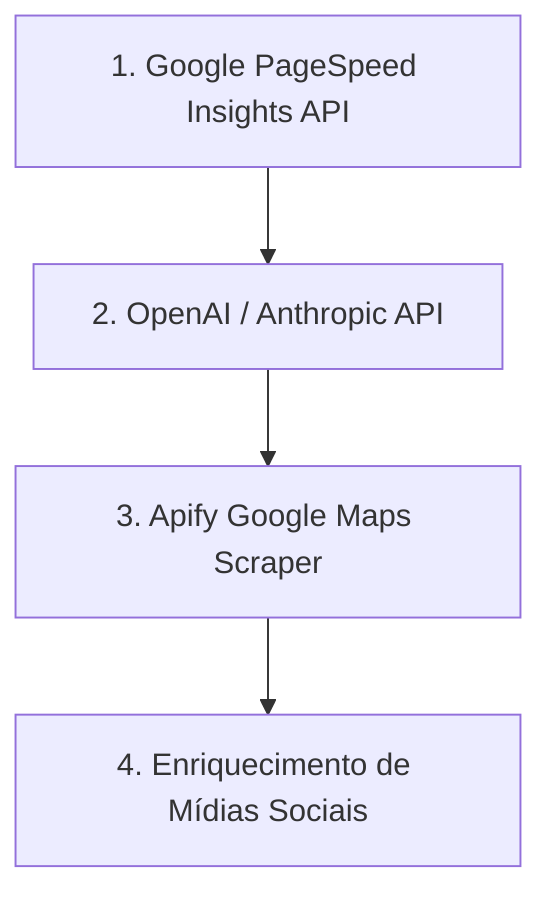

# CONSULTINGS APD AUTOMATION — Próximos Passos (Plano de Integração)

Esta documentação propõe a ordem estratégica recomendada e os detalhes de engenharia para migrar os mocks do MVP da plataforma para conexões reais com APIs externas de produção de forma segura e resiliente.

---

## 📅 Ordem de Integração Recomendada

A ordem recomendada prioriza integrações gratuitas e com menor complexidade de infraestrutura antes de migrar os dados estruturais mais complexos:

### 1. Google PageSpeed Insights API
* **Por que começar por aqui:** É uma API gratuita (dentro de limites generosos), altamente confiável, de simples requisição HTTP GET e com retorno de dados imediato em formato JSON padronizado.
* **Complexidade:** Baixa.

### 2. OpenAI / Anthropic API (Serviço de Diagnóstico)
* **Por que integrar em segundo:** O diagnóstico consultivo por IA é o maior diferencial comercial do sistema. A integração consiste em formular um prompt estruturado (system + user) e requisitar o retorno no formato JSON (*JSON Mode* ou *Structured Outputs*) para bater com os mesmos atributos de resposta do mock atual.
* **Complexidade:** Média.

### 3. Apify Google Maps Scraper (Varredura de Empresas)
* **Por que integrar em terceiro:** É o núcleo da busca de leads locais. No entanto, scrapers de mapas podem demorar minutos para extrair múltiplos resultados. A migração exigirá que o worker inicie o scraper de forma assíncrona, obtenha um ID de execução da tarefa no Apify e faça polling na API do Apify para saber se o scrape acabou, ou configure um *Webhook* para receber as empresas encontradas.
* **Complexidade:** Alta (requer controle de execução assíncrona robusto).

### 4. Enriquecimento de Mídias Sociais (Facebook & Instagram)
* **Por que deixar por último:** Redes sociais impõem fortes barreiras contra web scraping (limites de taxa IP, necessidade de cookies de login, captchas). Em vez de tentar raspar diretamente o Instagram/Facebook (o que causará bloqueios rápidos), a melhor estratégia é configurar o scraper do Apify Maps para extrair os links de redes sociais diretamente do rodapé do site do lead ou utilizar ferramentas especializadas de enriquecimento de contatos.
* **Complexidade:** Alta.

---

## 🛠️ Guia Técnico para Implementação Real

### 🚀 1. Implementando Google PageSpeed Insights
O integrador fará uma chamada `GET` simples:
* **Endpoint da API:** `https://www.googleapis.com/pagespeedonline/v5/runPagespeed`
* **Parâmetros:** `?url={siteUrl}&strategy=mobile&key={PAGESPEED_API_KEY}`
* **Mapeamento de Retorno:**
  * Score Geral: `data.lighthouseResult.categories.performance.score * 100`
  * LCP: `data.lighthouseResult.audits['largest-contentful-paint'].numericValue` (em milissegundos)
  * INP: `data.lighthouseResult.audits['interaction-to-next-paint'].numericValue` (em milissegundos)
  * CLS: `data.lighthouseResult.audits['cumulative-layout-shift'].numericValue` (float)

### 🧠 2. Implementando OpenAI API (Diagnóstico)
Configurar a chamada de chat completion definindo regras rígidas de retorno estruturado para evitar falhas de tipagem no frontend:
* **Modelo Recomendado:** `gpt-4o-mini` (baixo custo e excelente desempenho analítico).
* **Parâmetro Crucial:** Definir `response_format: { "type": "json_object" }` na chamada e solicitar no prompt os atributos exatos: `observed_facts`, `inferences`, `recommendations` e `email_draft`.
* **Prompt Base:**
  > *"Você é o arquiteto digital da plataforma CONSULTINGS APD. Analise as métricas reais fornecidas do lead: [Nome, Cidade, Site, PageSpeed, LCP, Instagram, Facebook, Nota Google] e devolva um JSON estruturado contendo a lista formatada de fatos, a inferência técnica das fraquezas digitais, recomendações práticas de consultoria de vendas e um template de email em português do Brasil convidando-o para uma call."*

### 🗺️ 3. Implementando Apify (Google Maps Scraper)
Dado que a chamada real é de longa duração, devemos evitar que o Express trave esperando o término.
* **Abordagem de Execução:**
  1. O worker faz um `POST` para `https://api.apify.com/v2/actor-tasks/{task_id}/runs?token={APIF_API_KEY}` contendo no payload `{ "queries": "{niche} in {location}" }`.
  2. A API do Apify retorna instantaneamente o `runId`.
  3. O worker armazena este `runId` no banco e atualiza o status para `scraping`.
  4. De 10 em 10 segundos, o worker faz um `GET` para `https://api.apify.com/v2/actor-runs/{runId}?token={APIF_API_KEY}` para monitorar se o status é `SUCCEEDED`.
  5. Uma vez concluído, o worker baixa o dataset do Apify, popula os leads e encerra a campanha.

---

## 🔒 Robustez e Resiliência
1. **Fallback Automático (Graceful Degradation):** Se a cota da API do PageSpeed estourar ou a OpenAI retornar timeout, o backend deve ter uma política de retentativa com backoff exponencial ou gerar um diagnóstico básico "fallback" local para não quebrar a usabilidade do prospecção.
2. **Caching de Performance:** Como a velocidade do site de uma empresa local não muda diariamente, cachear as respostas do PageSpeed em banco de dados por 30 dias evita requisições redundantes e economiza custos de chamadas de API.
3. **Limitação de Taxas (Rate Limiting):** Proteger os endpoints do backend Express contra chamadas excessivas que possam inflar rapidamente a fatura das APIs pagas (OpenAI e Apify).
