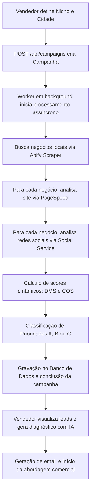

# AUTOMAÇÃO DE LEADS — Visão Geral do Projeto

A plataforma **Automação de Leads** é um sistema web B2B interno de prospecção consultiva e inteligência comercial focada no mercado brasileiro. A ferramenta foi projetada para apoiar times de vendas na identificação e priorização de potenciais clientes (leads) locais com base no nível de maturidade de sua presença digital.

---

## 🎯 Objetivo Comercial

O principal objetivo comercial da plataforma é otimizar o processo de atração e abordagem de clientes (Cold Outbound). Em vez de abordagens de vendas genéricas ou disparos em massa, a plataforma adota a metodologia de **venda consultiva**:

1. **Identificar oportunidades de forma orientada a dados:** Achar empresas locais que possuem reputação presencial excelente (boas avaliações), mas que apresentam deficiências graves de presença digital (sem site, site lento, ou inatividade em redes sociais).
2. **Priorizar leads com inteligência comercial:** O time de prospecção foca nos leads com maior probabilidade de conversão (Prioridade A), onde o retorno sobre a consultoria digital é mais óbvio e imediato.
3. **Gerar diagnósticos automatizados:** Equipar o vendedor com um relatório detalhado das falhas do cliente e um rascunho de e-mail altamente personalizado e estruturado, reduzindo o tempo de preparação da abordagem para poucos segundos.

---

## 🔄 Fluxo Geral de Valor

O fluxo de funcionamento do sistema é dividido nas seguintes etapas:

1. **Criação de Campanha (Radar):** O vendedor informa um segmento (Ex: *Clínicas Odontológicas*) e uma localização (Ex: *Curitiba, PR*).
2. **Varredura e Enriquecimento:** O sistema varre fontes externas para extrair informações sobre o negócio local, o desempenho do seu site e a atividade recente nas suas redes sociais.
3. **Motor de Pontuação:** A plataforma calcula scores para ordenar os leads:
   - **DMS (Digital Maturity Score):** Mede a saúde técnica digital da empresa.
   - **COS (Commercial Opportunity Score):** Mede a atratividade do lead baseado na combinação de alta reputação presencial e baixo DMS (alto gap digital).
4. **Diagnóstico & Abordagem:** O vendedor abre as oportunidades prioritárias, solicita um diagnóstico de IA estruturado apontando os pontos críticos e copia uma mensagem profissional adaptada pronta para envio manual.
5. **Entrega de Valor (Landing Pages):** Caso a venda seja fechada, a plataforma fornece templates de Landing Pages otimizados (como os contidos nas pastas `/mota-tobias-landing` e `/renata-flora-landing`) para rápida implantação da presença digital do cliente prospectado.

---

## 💻 Stack Tecnológico Atual

A aplicação é modularizada e utiliza tecnologias modernas, focando em simplicidade de execução, sem necessidade de configuração pesada ou dependências binárias complexas:

* **Backend:** 
  - **Node.js** com framework **Express** estruturando uma API REST leve.
  - **Processamento Assíncrono in-memory:** Um mecanismo de fila/worker leve para processar leads sem travar a thread de requisições HTTP.
  - **sql.js (SQLite WebAssembly):** Banco de dados relacional que roda 100% via WebAssembly, persistindo as transações localmente em disco como arquivo físico sem dependências binárias nativas.
* **Frontend:** 
  - **Next.js 14 (App Router)** utilizando React para controle de estado robusto.
  - **Tailwind CSS v3** fornecendo estilo visual corporativo, minimalista e muito responsivo.
  - **Recharts** na renderização e plotagem de gráficos dinâmicos de pizza e barra no Dashboard principal.
